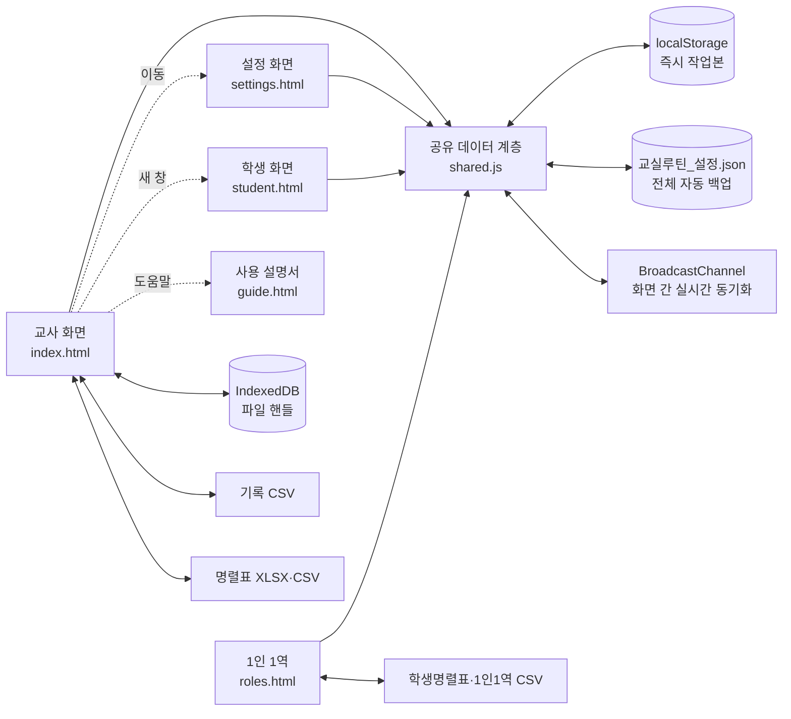
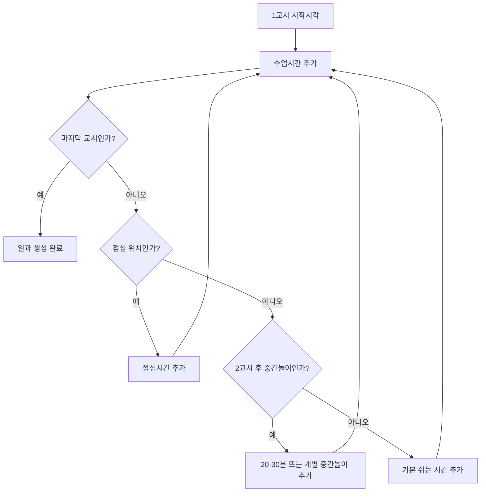
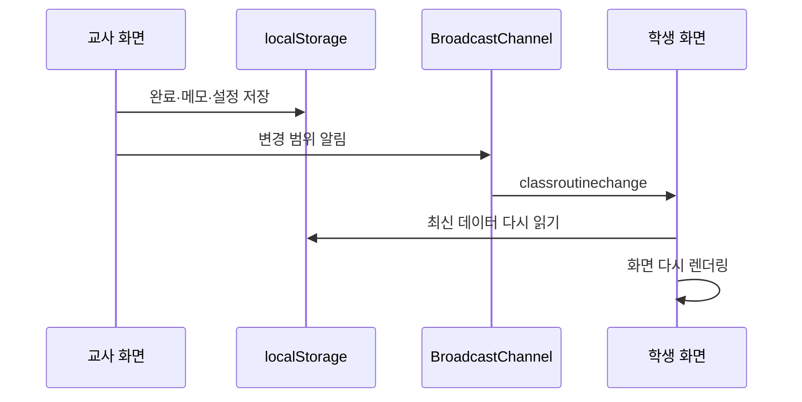

# 교실 루틴 프로그램 전체 설계도

## 0. 시각 디자인 — 햇살 학급 게시판

공통 마지막 스타일시트 `cute-theme.css`가 기존 화면 구조와 기능 코드는 그대로 두고 교사·학생·설정·1인 1역·설명서의 시각 언어를 통일한다. 크림색 종이 바탕, 잉크색 글자, 민트·하늘·코랄·노랑 포인트, 굵은 둥근 테두리와 스티커형 그림자를 사용한다. 화면마다 다른 장식보다 일정명·현재 시각·남은 시간을 가장 크게 보여 주는 정보 위계를 우선한다.

전체 화면 알림과 타이머는 어두운 광선형 배경을 사용하지 않는다. 밝은 크림색 게시판, 흰 시간 카드, 노란 남은 시간 칸과 파스텔 강조색으로 바꾸고, 큰 글자의 대비를 유지한다. 별도 이미지나 외부 디자인 자산을 내려받지 않으므로 기존의 로컬 전용·무전송 원칙도 유지된다.

## 1. 목표

이 프로그램은 담임교사가 하루 일과를 한 번 설정한 뒤 매일 반복해 활용하도록 돕는다. 핵심 목표는 다음과 같다.

1. 일정 생성과 수정이 짧고 단순할 것
2. 학생에게 필요한 정보는 멀리서도 읽을 수 있을 것
3. 교사용 정보와 학생 공개 정보를 명확하게 분리할 것
4. 기존 CSV 기록과 명렬표를 다음 실행에도 이어서 활용할 것
5. 인터넷이나 외부 서비스 없이 교실 컴퓨터 안에서 작동할 것

## 2. 전체 구조



프로그램은 서버 데이터베이스를 사용하지 않는다. 브라우저 저장소를 즉시 작업본으로 사용하고, 로컬 서버를 통해 모든 영속 파일을 `%USERPROFILE%\Documents\오늘도 차근차근`에 자동 보관한다. 설치 앱도 같은 폴더를 사용하며 소스·설치 파일과 실제 학급 데이터를 분리한다.

Windows 앱은 Electron 셸 안에서 같은 HTML·CSS·JavaScript와 `local-server.mjs`를 실행한다. 설치 앱이 임의의 `127.0.0.1` 포트를 직접 열기 때문에 사용자가 개발 서버를 별도로 실행하지 않는다. 렌더러에는 Node.js 권한을 주지 않고 격리된 preload 브리지로 일정 알림 요청과 알림 클릭 이벤트만 전달한다.

## 3. 화면별 책임

### 3.1 교사 화면 — `index.html`, `teacher.css`, `teacher.js`

- 오늘의 현재·다음 일정 표시
- 수업 제목을 `1교시 국어` 형식의 동일 크기 한 줄로 표시
- 일정 추가·수정·삭제
- 일정 완료와 완료 취소
- 학생용·교사용 수업 인계 메모 작성
- 날짜별 완료 기록 조회
- 공용 루틴 기록 CSV 자동 저장·기존 사본 병합·사본 다운로드
- 명렬표 XLSX·CSV 가져오기 및 이름 뽑기
- 교사 비공개 일일 메모
- 학생 화면 활성 여부 확인 후 알림 중복 방지

### 3.2 설정 화면 — `settings.html`, `settings.css`, `settings.js`

- 학교급 선택과 기본 수업시간 설정
- 운영 요일, 기본 쉬는 시간, 기본 사전 알림 설정
- 1~8교시 일과표 자동 생성
- 2교시 후 중간놀이와 3·4·5교시 후 점심시간 설정
- 운영 요일×교시 주간 시간표 과목 배정
- 빈 교시 생략과 같은 과목·교시의 반복 요일 병합
- 과목 기본 메시지·색상·효과음 관리
- 모든 일정의 확장 편집
- 알림 표시시간과 움직임 줄이기 설정
- 전체 설정 JSON 백업·복원
- 데이터 연결 센터에서 문서 폴더·파일별 상태·저장 개수 확인
- 설치 앱 데이터 폴더 열기와 사용자 확인 후 공용 작업본 강제 복원

### 3.3 학생 화면 — `student.html`, `student.css`, `student.js`

- 날짜·시계와 현재·다음 일정의 대형 표시
- 현재 카드와 전체 일과에서 교시·교과명을 같은 줄에 표시
- 오늘 전체 일과 표시
- 사전 알림과 시작 알림
- 과목 기본 메시지, 일정별 안내, 학생용 인계 메모 표시
- 이름 뽑기 결과 표시
- 전체 화면과 효과음 제어
- 교사 전용 정보 비노출

### 3.4 사용 설명서 — `guide.html`, `guide.css`, `guide.js`

- 처음 설정부터 매일 운영까지 작업 순서 안내
- 각 화면과 설정 항목 설명
- CSV·명렬표 연결과 개인정보 유의사항
- 문제 해결 안내
- 읽기 진행률, 현재 목차 표시, 인쇄·PDF 기능

### 3.5 1인 1역 — `roles.html`, `roles.css`, `roles.js`

- PPT에서 확인한 14개 역할 묶음과 23개 기본 자리 제공
- 명렬표의 번호·이름을 학생 선택 목록과 미배정 목록에 사용
- 한 학생이 두 역할에 배정되지 않도록 중복 차단
- 전체 자동 배정, 자리별 수동 배정과 전체 비우기
- 역할명·업무 안내·분류·색상·필요 인원 추가 및 수정
- 인쇄·PDF용 게시판 출력
- 전용 `roles-print.html`에서 모든 역할을 5열×3행 중심으로 재배치해 A4 가로 한 장에 출력
- `학생명렬표.csv`, `1인1역_배정.csv` 자동 불러오기·저장

## 4. 공유 데이터 계층

`shared.js`는 각 화면이 같은 규칙으로 데이터를 읽고 쓰도록 하는 단일 진입점이다.

### 4.1 저장 키

| 키 | 내용 |
|---|---|
| `classRoutine.settings.v3` | 학교급, 시간 기준, 일과 생성 옵션, 알림 설정 |
| `classRoutine.routines.v3` | 전체 일정 |
| `classRoutine.records.v2` | 완료 기록 |
| `classRoutine.subjects.v1` | 과목과 기본 메시지 |
| `classRoutine.handoffs.v1` | 다음 수업 인계 메모 |
| `classRoutine.memos.v2` | 날짜별 교사 비공개 메모 |
| `classRoutine.roster.v1` | 명렬표 브라우저 사본 |
| `classRoutine.weeklyTimetables.v1` | 월요일 날짜를 키로 한 주차별 시간표 이력 |
| `classRoutine.duties.v1` | 1인 1역 역할 구성과 학생 배정의 브라우저 작업본 |
| `classRoutine.alerted.v3.YYYY-MM-DD` | 당일 이미 표시한 알림 |
| `classRoutine.studentHeartbeat` | 학생 화면 활성 상태 |
| `classRoutine.drawResult` | 최근 이름 뽑기 결과 |

### 4.2 설정 데이터

```js
{
  schoolLevel: "elementary", // elementary | middle | high | custom
  className: "우리 반",
  greeting: "오늘도 좋은 하루 보내세요.",
  classMinutes: 40,
  breakMinutes: 10,
  defaultPreAlert: 2,
  activeDays: [1, 2, 3, 4, 5],
  firstStart: "09:00",
  periodCount: 6,
  timetable: {
    1: { 1: "국어 과목 ID", 2: "수학 과목 ID" },
    2: { 1: "수학 과목 ID", 2: "체육 과목 ID" }
  },
  commonMessages: {
    break: "물을 마시거나 화장실을 다녀온 뒤 다음 수업을 준비해요.",
    middlePlay: "안전하게 놀이하고 종이 울리기 전에 교실로 돌아와요.",
    lunch: "손을 깨끗이 씻고 질서를 지켜 맛있게 먹어요."
  },
  middlePlay: { enabled: true, afterPeriod: 2, duration: 20 },
  lunch: { enabled: true, afterPeriod: 4, duration: 50 },
  sound: true,
  globalSound: "chime",      // chime | wood | sparkle
  soundVolume: 100,          // 50~150, 백분율
  alertDisplaySeconds: 0,
  reducedMotion: false
}
```

### 4.3 일정 데이터

```js
{
  id: "고유 ID",
  startTime: "09:00",
  type: "class",             // class | break | other
  category: "수업",
  subjectId: "subject-id",
  title: "1교시 국어",
  durationMode: "default",   // default | custom
  duration: 40,
  preAlertMode: "default",   // default | custom | off
  preAlertMinutes: 2,
  eventMessage: "교과서를 준비해요.",
  sound: "chime",            // chime | wood | sparkle | none
  color: "green",
  activeDays: [1, 2, 3, 4, 5],
  enabled: true,
  generated: true,
  period: 1,
  weekStart: "2026-08-24"
}
```

`durationMode`이 `default`이면 학교급의 현재 기본시간을 사용한다. `custom`이면 일정에 저장된 시간을 사용한다. 따라서 학교급 변경 시 개별 일정의 예외시간이 보존된다.

### 4.4 과목 데이터

```js
{
  id: "subject-id",
  name: "국어",
  defaultMessage: "국어책과 필기도구를 준비해요.",
  color: "green",
  sound: "chime",
  enabled: true
}
```

기본 과목은 국어, 사회, 도덕, 수학, 과학, 체육, 음악, 미술, 영어, 자율, 자치, 동아리이다.

### 4.5 완료 기록 데이터

```js
{
  id: "고유 ID",
  date: "2026-08-26",
  routineId: "일정 ID",
  title: "국어 · 1교시 국어",
  scheduledTime: "09:00",
  completedAt: "09:42",
  status: "완료"
}
```

CSV 열 순서는 `날짜, 루틴ID, 루틴, 예정시간, 완료시간, 상태`이다.

교사 화면의 진행 상태와 영구 기록은 구분한다. `hasEnded()`가 현재 시각을 일정의 시작 시각+소요 시간과 비교해 종료 여부를 계산하며, `오늘의 기록` 진행률과 일정 카드의 완료 표시는 `종료 시각 경과 OR 수동 완료 기록 존재`를 사용한다. 자동 종료는 매분 다시 계산하며 로컬 저장소나 CSV에 가상 기록을 만들지 않는다. 사용자가 `일정 종료`를 직접 누른 경우에만 실제 완료 시각, 다음 수업 인계 메모와 CSV 행을 저장한다.

### 4.6 일정 카드 큰 보기

교사 화면의 상단 현재·다음 카드와 오늘의 루틴 행을 클릭하거나 키보드 Enter·Space로 열면 기존 알림 대화상자를 `preview` 단계로 재사용한다. 수동 큰 보기는 시작–종료 시각, 과목 기본 안내, 일정 안내, 학생 인계 메모와 교사 메모를 표시한다. 자동 알림과 달리 효과음을 재생하지 않고 다시 알림 버튼을 숨긴다. 카드 내부의 일정 종료·수정 버튼은 큰 보기 이벤트보다 우선한다.

### 4.6 수업 인계 데이터

```js
{
  id: "고유 ID",
  sourceRoutineId: "메모를 남긴 수업",
  targetRoutineId: "다음 수업",
  targetDate: "2026-08-27",
  studentNote: "학생 화면에 보이는 메모",
  teacherNote: "교사 화면에만 보이는 메모",
  createdAt: "ISO 날짜시간",
  archived: false
}
```

대상은 시간순 다음 `class` 일정이다. 쉬는 시간과 기타 일정은 건너뛰며, 같은 날 다음 수업이 없으면 14일 안의 다음 운영일 첫 수업을 찾는다.

## 5. 일과표 생성 규칙



- 교시 수는 1~8로 제한한다.
- 중간놀이와 점심은 해당 위치의 일반 쉬는 시간을 대체한다.
- 자동 생성 일정은 `generated: true`로 표시한다.
- 새 일과표 적용 시 이전 자동 생성 일정만 교체한다.
- 사용자가 ‘개별 일정 추가’로 만든 `generated: false` 일정은 유지한다.
- 주간 시간표의 빈 셀은 수업 일정으로 만들지 않는다.
- 같은 교시·과목·시각이 여러 요일에 반복되면 하나의 일정에 반복 요일을 합친다.
- 일반 쉬는 시간은 그날 뒤 교시가 있을 때만 만들고, 중간놀이와 점심은 해당 직전 교시가 있으면 만든다.
- 시스템 하교 일정은 현재 주 시간표의 요일별 실제 마지막 과목을 기준으로 만든다. 마지막 과목이 5교시면 13:50, 6교시면 14:40이다.
- 5교시 하교와 6교시 하교를 `builtin-dismissal-5`, `builtin-dismissal-6`으로 나누고, 같은 마지막 교시를 가진 요일을 `activeDays`로 묶는다.
- 저장된 현재 주 시간표에서 과목이 없는 요일은 자동 하교를 표시하지 않는다. 현재 주 시간표가 전혀 없을 때만 전체 `periodCount`와 운영 요일을 대체 기준으로 사용한다.
- 주차 메타데이터의 `periodCount`는 편집 가능한 최대 교시 틀이므로, 저장된 시간표가 있을 때는 하교 시각 결정에 직접 사용하지 않는다. 예를 들어 `periodCount: 6`이어도 6교시 과목이 비어 있으면 실제 마지막 교시는 5교시다.
- 하교 일정은 기본 사전 알림을 따르며, 시간표 저장·폴더 CSV 복원·앱 시작 시 다시 계산한다.
- 이전 버전의 `builtin-dismissal`과 현재 주에 맞지 않는 `builtin-dismissal-*`은 재계산 과정에서 제거한 뒤 필요한 요일 묶음만 다시 만든다.
- 마지막 교시가 5·6이 아니면 해당 요일의 시스템 하교 일정을 표시하지 않는다.
- 한 주는 월요일~일요일로 계산하며 `weekStart`가 현재 날짜의 주 시작일과 같은 일정만 표시한다.
- 다른 주의 자동 생성 일정은 삭제하지 않고 주차별로 함께 보관한다.

### 주차별 시간표 이력

```js
{
  "2026-08-24": {
    start: "2026-08-24",
    end: "2026-08-30",
    isoWeek: 35,
    monthWeek: 5,
    timetable: { 1: { 1: "subject-1" } },
    schedule: { periodCount: 6, firstStart: "09:00" },
    savedAt: "2026-08-26T01:00:00.000Z"
  }
}
```

시간표 CSV는 모든 주차의 메타 행과 수업 행을 저장한다. 로컬 개발 서버의 `/api/timetable-csv`가 공용 데이터 폴더의 고정 파일 `주간시간표_이력.csv`를 읽고 쓴다. 서버 시작 시 기존 파일과 브라우저 이력을 저장시각 기준으로 병합하고, 가져온 주차의 실제 일정도 다시 생성한다. 서버 API를 사용할 수 없는 직접 HTML 실행 환경에서는 브라우저 파일 연결을 대체 경로로 사용한다.

시간표 저장 대상은 `선택한 주`와 그 주를 기준으로 7일 뒤인 `다음 주` 중에서 고른다. 다음 주 저장은 편집 중인 표와 일과 구조 스냅샷을 다음 주 월요일 키로 보관하고, 해당 주의 자동 생성 일정만 교체한다. 현재 주의 보관본과 생성 일정은 변경하지 않는다. 다음 주에 기존 보관본이 있으면 저장 전에 기존 수업 수를 알리고 확인을 받은 뒤 덮어쓴다. 저장 후에는 대상 주로 이동해 저장 결과를 바로 보여 준다.

### 로컬 서버 저장 API

| 요청 | 동작 |
|---|---|
| `GET /api/storage-info` | 공용 데이터 폴더의 절대 경로와 고정 파일명 반환 |
| `GET /api/timetable-csv` | 공용 데이터 폴더의 시간표 CSV를 반환하며 파일이 없으면 빈 응답을 반환 |
| `PUT /api/timetable-csv` | 최대 5MB의 CSV를 고정 파일 `주간시간표_이력.csv`에 저장 |
| `GET /api/roster-csv` | 공용 명렬표 사본 `학생명렬표.csv` 반환 |
| `PUT /api/roster-csv` | 최대 2MB의 명렬표 CSV 저장 |
| `GET /api/roles-csv` | 역할 정의와 현재 배정이 담긴 `1인1역_배정.csv` 반환 |
| `PUT /api/roles-csv` | 최대 2MB의 1인 1역 CSV 저장 |
| `GET /api/records-csv` | 직접 종료·취소 기록이 담긴 `루틴기록.csv` 반환 |
| `PUT /api/records-csv` | 최대 5MB의 루틴 기록 CSV 저장 |
| `GET /api/state-json` | 설정·과목·일정·메모·시간표 등 전체 작업본 반환 |
| `PUT /api/state-json` | 최대 10MB의 `교실루틴_설정.json` 자동 백업 |

API는 `127.0.0.1`에 바인딩된 로컬 서버에서만 제공한다. 기본 경로는 `%USERPROFILE%\Documents\오늘도 차근차근`이며 `CLASS_ROUTINE_DATA_DIR` 환경 변수로 시험 경로만 바꿀 수 있다. 서버 시작 시 기존 소스 폴더의 CSV는 새 위치에 대상 파일이 없을 때만 복사하고 원본을 삭제하거나 덮어쓰지 않는다.

교사·학생 랜딩 화면은 `shared.js` 로드 시 다음 순서로 복구한다.

1. 현재 주의 생성 일정이 이미 있으면 그대로 사용한다.
2. 일정이 없으면 `classRoutine.weeklyTimetables.v1`의 현재 주 보관본으로 재생성한다.
3. 로컬 서버가 있으면 `주간시간표_이력.csv`를 읽어 더 최신인 주차를 병합한다.
4. 병합 후 현재 주 일정을 다시 확인하고 필요한 경우 재생성한다.
5. 브라우저의 전체 주차 이력을 공용 데이터 폴더 CSV에 다시 기록한다.

따라서 설정 페이지를 먼저 열지 않아도 랜딩 화면에서 복원이 이루어진다.

## 6. 메시지 합성 규칙

학생 화면과 사전 알림에 표시되는 메시지는 다음 세 층으로 구성된다.

1. 과목 기본 메시지
2. 일정별 추가 안내
3. 이전 수업의 학생용 인계 메모

일반 쉬는 시간·중간놀이·점심은 과목 메시지가 없으므로 `commonMessages`의 유형별 공통 안내를 사용한다. `messagesFor()`는 일정의 `eventMessage`가 있으면 개별 문구를 먼저 반환하고, 비어 있을 때만 `commonMessageFor()`로 현재 공통 설정을 조회한다. 공통 문구를 일정에 복사하지 않기 때문에 설정을 한 번 저장하면 이미 생성된 모든 주차와 앞으로 생성할 시간표에 즉시 반영된다.

교사용 인계 메모는 교사 화면에서만 표시한다. 학생 화면 코드에는 교사용 메모를 렌더링하는 경로를 두지 않는다.

## 7. 알림 설계

1. 각 화면은 현재 분과 일정 시작 분을 비교한다.
2. `preAlertFor()`가 반환한 분만큼 전이면 사전 알림을 표시한다.
3. 시작 분이면 시작 알림을 표시한다.
4. 당일 알림 키에 `일정ID:단계`를 저장해 같은 알림을 반복하지 않는다.
5. 학생 화면은 1초마다 heartbeat를 기록한다.
6. 교사 화면은 최근 5초 이내 heartbeat가 있으면 자체 알림을 생략한다.

알림 대화상자의 시간 정보는 `현재 시각`, `일정 시작`, `시작까지`의 세 칸으로 구분한다. 현재 시각은 초 단위로 계속 갱신하고, 일정 시작 칸에는 종료 시각도 보조 정보로 표시한다. 시작 전에는 남은 시간을 `MM:SS` 또는 `H:MM:SS`로 줄여 표시하며, 시작 뒤에는 `지금 시작`, `진행 중`, `종료됨` 상태로 전환한다. 교사와 학생 화면은 같은 계산 규칙과 시각적 순서를 사용한다.

교사 `dialog`와 학생의 고정 레이어는 별도의 상단 오프셋 없이 뷰포트를 크게 사용한다. 일반 일정 알림·빠른 타이머·청소·이름 뽑기·편집 대화상자의 너비와 글꼴을 확대하며, 사용 가능한 높이가 부족하면 팝업 내부 스크롤을 사용한다.

교사 상단 네비게이션의 빠른 타이머는 1~10분 프리셋을 제공한다. 선택 즉시 `endsAt` 절대 시각을 `classRoutine.quickTimer.v1`에 저장하므로 새로고침과 탭 간 동기화 뒤에도 같은 남은 시간을 계산한다. 시작하면 교사와 학생 화면 모두 대형 타이머를 자동으로 열며, 시각 정보의 우선순위는 `남은 시간 MM:SS` → 진행 막대 → 작은 종료 예정 시각 순이다. `작게 보기` 후에도 상단 카운트다운은 유지되고, 종료 순간 큰 화면을 한 번 다시 열어 완료 상태를 알린다. 교사 화면은 실행·중지·종료 효과음을 담당하며 종료 알림은 `notifiedAt`으로 한 번만 재생하고 8초 뒤 상태를 정리한다.

### 7.1 아침활동과 1교시 전 쉬는 시간

- 공유 데이터 계층은 평일 08:40 시작, 개별시간 15분인 `builtin-morning-0840` 아침활동을 보장한다.
- 아침활동 안내는 우유 마시기를 첫 문장과 🥛 표시로 강조하고 독서·레서·마타수학 및 오늘 시간표 확인을 함께 제시한다.
- 평일 08:55 시작, 개별시간 5분인 `builtin-morning-break-0855` 쉬는 시간을 이어서 보장하며 09:00에 종료한다.
- 같은 시작 시각과 분류의 사용자 일정이 있으면 자동 일정을 중복 생성하지 않는다. 시스템 일정의 개별 안내 문구는 일정 수정 화면에서 바꿀 수 있다.
- 두 일정 모두 전체 기본 사전 알림과 공통 효과음 설정을 따른다.

### 7.2 청소 시간과 1인 1역 안내

- 공유 데이터 계층은 평일 13:40 시작, 개별시간 10분인 `builtin-cleaning-1340` 일정을 보장한다.
- 청소 알림용 `dutyAssignmentsForDate()`는 전체 배정표에서 현재 요일의 크린토피아 한 역할만 남긴다. 일반 역할과 설정·출력용 전체 배정표는 필터링하지 않는다.
- 청소 알림은 교사 `dialog`와 학생 알림 레이어 모두 `100vw × 100dvh`를 사용한다. 역할명 38px, 학생 이름 32px을 최소 기준으로 삼고 낮은 화면에서는 축소 대신 내부 스크롤을 허용한다.
- 기존에 13:40 청소 일정이 있으면 자동 일정을 중복 생성하지 않는다.
- 기본 사전 알림 2분을 따르며 사용자가 전체 기본값을 바꾸면 함께 바뀐다.
- 개발 서버의 `/api/roles-csv`에서 `1인1역_배정.csv`를 읽어 브라우저 작업본과 동기화한다.
- 청소 알림은 일반 메시지 아래에 역할 14개와 각 자리의 학생 번호·이름을 큰 카드로 표시한다.
- 교사 화면과 학생 화면 모두 같은 배정 데이터를 사용하며, 학생 화면의 청소 알림은 최소 30초 동안 유지한다.
- 두 일정이 동시에 진행 중이면 `primaryCurrentRoutine()`이 청소 일정을 최우선으로 선택하고, 그 밖의 겹침은 나중에 시작한 일정을 우선한다. 따라서 점심·수업이 13:40 이후까지 이어져도 청소는 13:40~13:50에 교사와 학생의 상단 현재 일정으로 표시된다. 이 우선순위는 표시 선택만 바꾸며 사용자가 저장한 점심시간 길이는 임의로 수정하지 않는다.

효과음은 `shared.js`의 Web Audio API 합성기로 한 번만 정의해 교사·학생·설정 화면이 같은 음색과 음량 기준을 사용한다. 새 설정의 `sound`는 기본 `true`, `globalSound`는 `chime`이다. 실제 자동 재생은 과목·일정에 남은 기존 `sound` 필드보다 `globalSound`를 우선해 사용하므로 사용자가 고른 한 가지 음색이 모든 사전 알림·시작·완료 소리에 적용된다. 설정 시험만 `force` 옵션으로 누른 카드의 음색을 재생한다. 기본 출력 레벨은 초기 구현보다 약 2배 높고, `soundVolume`으로 50~150% 범위에서 조절한다. 각 패턴의 음 여운은 기본 정의의 3배로 늘리고, 패턴의 실제 재생 길이와 같은 묵음 구간을 둔 뒤 총 3회 반복한다. 교사 화면의 `일정 확인`과 학생 화면의 `확인했어요`를 누르면 `stopSound()`가 예약된 반복까지 즉시 중단한다. 새 효과음을 시작할 때도 예약된 이전 음은 중단해 긴 반복음끼리 겹치지 않게 한다. 여러 음이 겹칠 때의 왜곡을 줄이기 위해 출력단에 다이내믹 컴프레서를 둔다. 실제 자동 알림은 `sound`가 켜져 있을 때만 재생된다. 브라우저 자동 재생 정책 때문에 교사·학생 화면은 사용자가 페이지를 한 번 눌러야 정상 재생된다.

## 8. 파일 연속성 설계

### 기록 CSV

1. 로컬 서버가 공용 데이터 폴더의 `루틴기록.csv`를 자동으로 읽는다.
2. 기존 CSV를 브라우저 기록과 중복 없이 합친다.
3. 완료 또는 완료 취소 때마다 전체 파일을 자동 갱신한다.
4. `사본 연결`을 사용하면 사용자가 고른 다른 파일에도 같은 기록을 추가로 쓴다.
5. 서버나 연결 파일 접근이 불가능해도 브라우저 기록은 유지한다.

### 명렬표

- XLSX와 CSV를 지원한다.
- 첫 행에서 `번호`, `이름`, `성명` 헤더를 탐색한다.
- XLSX는 ZIP 구조와 첫 워크시트를 브라우저에서 직접 해석한다.
- 읽은 명렬은 이름 뽑기를 위해 브라우저에 사본을 저장한다.

### 파일 핸들

File System Access API의 핸들은 추가 기록 사본이나 직접 HTML 실행용 시간표 파일에만 사용한다. 핸들은 `ClassRoutineFiles` IndexedDB의 `handles` 저장소에 보관하며 브라우저가 재접속 권한을 요구하면 사용자가 다시 승인한다.

### 전체 작업본 자동 백업

`shared.js`는 설정·과목·일정·수동 기록·인계 메모·교사 메모·명렬표·주간 시간표·1인 1역을 `교실루틴_설정.json`에 300ms 지연으로 묶어 저장한다. 서버는 HTML을 제공할 때 이 파일을 부트스트랩 데이터로 삽입한다. 새 브라우저 계정처럼 로컬 작업본이 없는 경우에는 자동 복원하고, 기존 작업본과 백업이 모두 있으면 저장시각이 더 최신인 쪽을 사용한다.

### 설치와 데이터 경로

- 설치형 앱: `%LOCALAPPDATA%\Programs\오늘도 차근차근`
- 개발 소스: 사용자가 선택한 `ClassRoutine` 작업 폴더
- 실제 학급 데이터: `%USERPROFILE%\Documents\오늘도 차근차근`

설치·업데이트 파일에는 실제 학생 데이터가 포함되지 않는다. 배포 산출물에는 빈 CSV 양식만 포함한다.

### Windows 셸과 알림

- `electron-main.cjs`는 단일 앱 인스턴스, 자체 로컬 서버, 주 창, 트레이와 Windows 알림을 관리한다.
- 창 닫기는 트레이 숨김이며 `완전히 종료`만 일정 감시를 끝낸다.
- `backgroundThrottling: false`와 자동 재생 정책으로 숨겨진 교사 화면도 분 단위 일정을 확인하고 설정한 효과음을 재생한다.
- 시작 프로그램은 기본 사용하며 트레이 체크 메뉴로 끌 수 있고 `데스크톱설정.json`에 보관한다.
- 알림 본문은 일정 시각과 학생 공개 안내만 사용한다. 알림 클릭은 주 창을 앞으로 가져와 `desktop:open-routine`으로 해당 일정의 큰 보기를 연다.
- `preload.cjs`는 `notifyRoutine`과 `onOpenRoutine` 두 기능만 공개하며 `nodeIntegration`은 끄고 `contextIsolation`과 sandbox를 켠다.
- 개발 서버의 live reload는 설치 앱에서 사용하지 않으므로 소스 변경 중 보이는 순간 재로딩이 배포본에는 없다.

### 급식·날씨와 알레르기 정보

- 로컬 서버가 NEIS에는 교육청 코드·학교 코드·날짜만, 기상청에는 격자 좌표·기준 시각만 전송한다.
- 학생 이름과 알레르기 번호는 외부 요청에 포함하지 않는다. 받아 온 급식 메뉴의 알레르기 번호와 `학생명렬표.csv`를 로컬에서 대조한다.
- 교사 화면에는 학생별 주의 항목을 표시하지만, 프로젝터용 학생 화면에는 이름이나 개인 프로필 없이 학급 공통 메뉴와 알레르기 번호만 표시한다.
- 외부 서비스 키는 전체 작업본과 분리한 `외부연동설정.json`에 저장하며 저장 설정 API는 키의 존재 여부만 반환한다.
- 날씨 안내는 온도·강수확률·풍속에 대한 앱 내부의 보수적 보조 기준이다. 학교 상황과 현장 판단을 대체하지 않는다.
- API 결과는 급식 30분, 날씨 10분 동안 메모리 캐시해 불필요한 외부 요청을 줄인다.

### 교사 화면 보조 패널 배치

`오늘의 기록`은 일정 목록 오른쪽 열의 일반 문서 흐름에 둔다. `sticky`나 `fixed` 위치를 쓰지 않으므로 페이지 스크롤 시 따라오지 않고 급식·날씨·다른 자료를 가리지 않는다.

## 9. 실시간 동기화



동기화 메시지에는 개인정보나 전체 데이터가 아니라 변경 범위와 시각만 보낸다. 실제 데이터는 각 화면이 같은 `localStorage`에서 다시 읽는다.

## 10. 이전 버전 마이그레이션

- v3 설정이 없으면 v2 설정을 읽어 새 기본 구조와 병합한다.
- v3 일정이 없으면 v2 일정을 정규화해 저장한다.
- 기존 일정에 없는 유형, 시간 기준, 알림 기준, 요일 등의 필드를 기본값으로 채운다.
- 마이그레이션은 `shared.js` 로드 시 한 번 수행된다.

## 11. 접근성과 표시 원칙

- 학생 화면의 핵심 정보는 큰 글씨와 높은 명암으로 표시한다.
- 색만으로 상태를 표현하지 않고 문구와 시간 정보를 함께 제공한다.
- `aria-live`를 사용해 현재 일정과 알림 변화를 보조기기에 전달한다.
- 움직임 줄이기 설정과 `prefers-reduced-motion`에 대응할 수 있는 클래스를 제공한다.
- 좁은 화면에서는 한 열 구조로 전환한다.
- 사용 설명서는 인쇄와 PDF 저장에 맞춘 별도 출력 스타일을 제공한다.

## 12. 보안과 한계

- 설정·일정의 즉시 작업본은 현재 브라우저 프로필에 저장된다.
- 같은 개발 서버 주소를 사용하는 브라우저 계정은 폴더의 시간표·명렬표·1인 1역 CSV를 통해 해당 데이터를 복원할 수 있다.
- Windows 사용자별 폴더에 프로그램을 두면 다른 Windows 계정에서는 접근할 수 없으므로 공용 사용 시 공유 폴더 배포가 필요하다.
- 기록 CSV와 명렬표는 인터넷의 외부 서버로 업로드되지 않는다.
- `127.0.0.1` 개발 서버는 현재 컴퓨터에서만 접근하는 구성을 전제로 한다.
- 학생 개인정보 파일의 실제 보관 위치와 접근 권한은 학교 보안 지침을 따른다.
